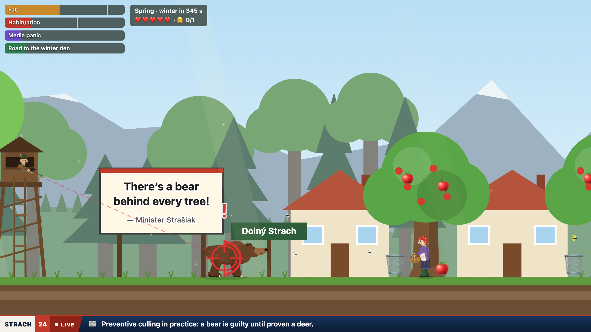
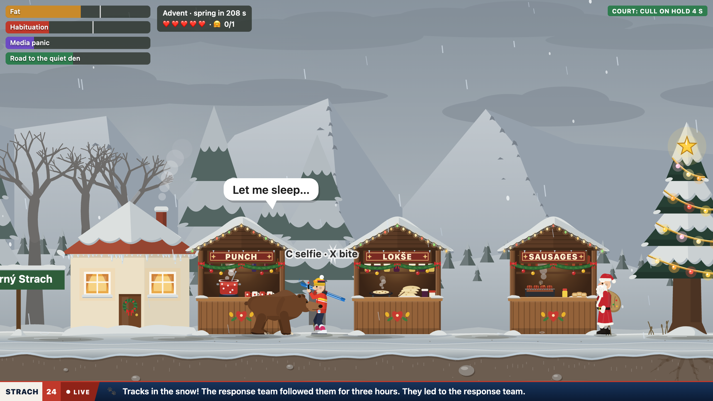
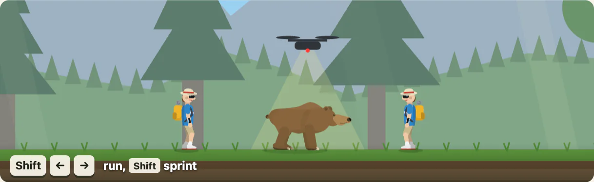

# Za stromom

A satirical 2D browser game about a brown bear from Liptov, Slovakia. Politicians blame bears for everything,
hunters shoot even where bears are protected, the STRACH 24 news channel reports one breaking story after another,
and the only safe place is behind a thick tree.

**[▶ Play online](https://damikun.github.io/pozor-medved/?lang=en)** · [Slovensky](https://damikun.github.io/pozor-medved/)
· [Deutsch](https://damikun.github.io/pozor-medved/?lang=de) · [Español](https://damikun.github.io/pozor-medved/?lang=es)

The game runs right in the browser, nothing to install. Offline, just open `index.html`.

## Levels

- **Summer in the Valley**: from the spring den through the village of Dolný Strach, a cornfield, the Pribylina
  open-air museum, a sheepfold and a hotel, then by chairlift up to Zelené pleso in the High Tatras and the winter den.
- **Winter on the Slopes**: a warm Advent and the snow cannons woke you up. Cross the ski resort and the Christmas
  market of Liptovský Mikuláš to reach a quiet den.

**Goal:** reach the den with enough fat (85% in summer, 65% in winter) and hug someone at least once; a selfie
with a tourist counts too. Without a hug the den won't let you in.

## How to play

## Controls

| Key | What it does |
| --- | --- |
| ← → | walk |
| Shift | sprint (on a phone, double-tap an arrow and hold) |
| ↓ | hide behind a thick tree |
| ↑ | tap to jump, hold at a thick tree to climb |
| Space | jump; landing on a hunter's head knocks him down |
| C | hug a person, take a selfie with a tourist, or shake a hunting stand until the hunter falls out |
| X | bite a person (turns you into a problem bear) |
| P | pause |
| M | sound on or off (also the 🔊 button on the start screen and in the pause menu) |

On phones there are touch buttons, and 🤗 and 🦷 appear next to people.
