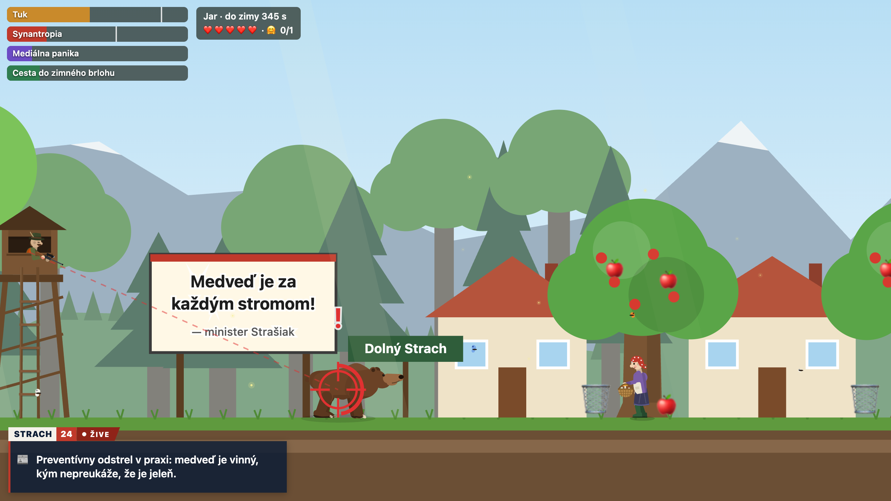

# Za stromom

Satirická 2D hra v prehliadači o medveďovi z Liptova. Politici z medveďov robia vinníkov všetkého, poľovníci
strieľajú aj tam, kde sú chránené, a jediná istota je hrubý strom. Prejdi dolinou od jarného brlohu do zimného
a cestou nažer aspoň 85 % tuku.

**[▶ Hrať online](https://damikun.github.io/pozor-medved/)**

Hra beží priamo v prehliadači, nič netreba inštalovať. Bez internetu stačí otvoriť `index.html`.

| Kláves | Čo robí |
| --- | --- |
| ← → | chôdza |
| Shift | šprint |
| ↓ | schovať sa za strom |
| ↑ | skok, pri strome lezenie |
| medzerník | skok |
| P | pauza |

Postavy, obec aj titulky sú vymyslené. Fakty na konci hry sú skutočné a majú zdroj.
