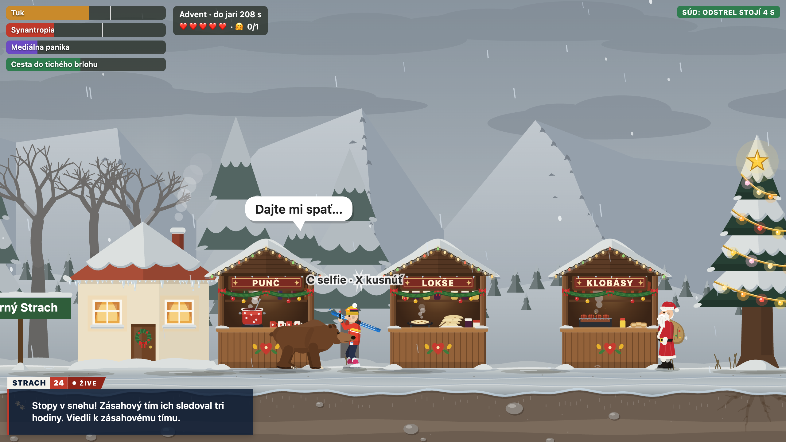

# Za stromom

Satirická 2D hra v prehliadači o medveďovi z Liptova. Politici z medveďov robia vinníkov všetkého, poľovníci
strieľajú aj tam, kde sú chránené, televízia STRACH 24 hlási jednu mimoriadnu správu za druhou a jediná istota
je hrubý strom.

**[▶ Hrať online](https://damikun.github.io/pozor-medved/)** · [English](https://damikun.github.io/pozor-medved/?lang=en)
· [Deutsch](https://damikun.github.io/pozor-medved/?lang=de) · [Español](https://damikun.github.io/pozor-medved/?lang=es)

Hra beží priamo v prehliadači, nič netreba inštalovať. Bez internetu stačí otvoriť `index.html`.

## Levely

- **Leto v doline**: od jarného brlohu cez Dolný Strach, salaš, hotel a národný park do zimného brlohu.
- **Zima na svahu**: teplý advent a snežné delá ťa zobudili. Cez lyžiarske stredisko a vianočné trhy
  v Hornom Strachu musíš dôjsť do tichého brlohu.

**Cieľ:** dôjsť do brlohu s dosť tukom (leto 85 %, zima 65 %) a aspoň raz niekoho objať, selfie s turistom
sa ráta tiež. Bez objatia ťa brloh nepustí.

## Ovládanie

| Kláves | Čo robí |
| --- | --- |
| ← → | chôdza |
| Shift | šprint (na mobile dvakrát ťukni na šípku a drž) |
| ↓ | schovať sa za hrubý strom |
| ↑ | ťuknutím skok, podržaním pri hrubom strome lezenie |
| medzerník | skok; dopadom na hlavu zvalíš poľovníka |
| C | pri človeku objatie, pri turistovi selfie, pod posedom ním zatrasieš a poľovník vypadne |
| X | kusnúť človeka (urobí z teba problémového medveďa) |
| P | pauza |

Na mobile sú dotykové tlačidlá a pri ľuďoch sa ukážu aj 🤗 a 🦷.

## Jazyky

Hra je po slovensky, anglicky, nemecky a španielsky. Jazyk prepneš cez ⚙️ v rohu úvodnej obrazovky a hra si ho
zapamätá. Odkaz s `?lang=en`, `?lang=de` alebo `?lang=es` otvorí hru rovno v danom jazyku. Predvolený jazyk
stránky určuje `<meta name="default-language" content="sk">` v `index.html`.

## Vývoj

Bez závislostí a bez buildu. Testy spustíš cez `npm test`, záznamy behov autopilota sa obnovia cez
`npm run test:update`.

Postavy, obce aj titulky sú vymyslené. Miesta okolo Pribyliny sú skutočné.
